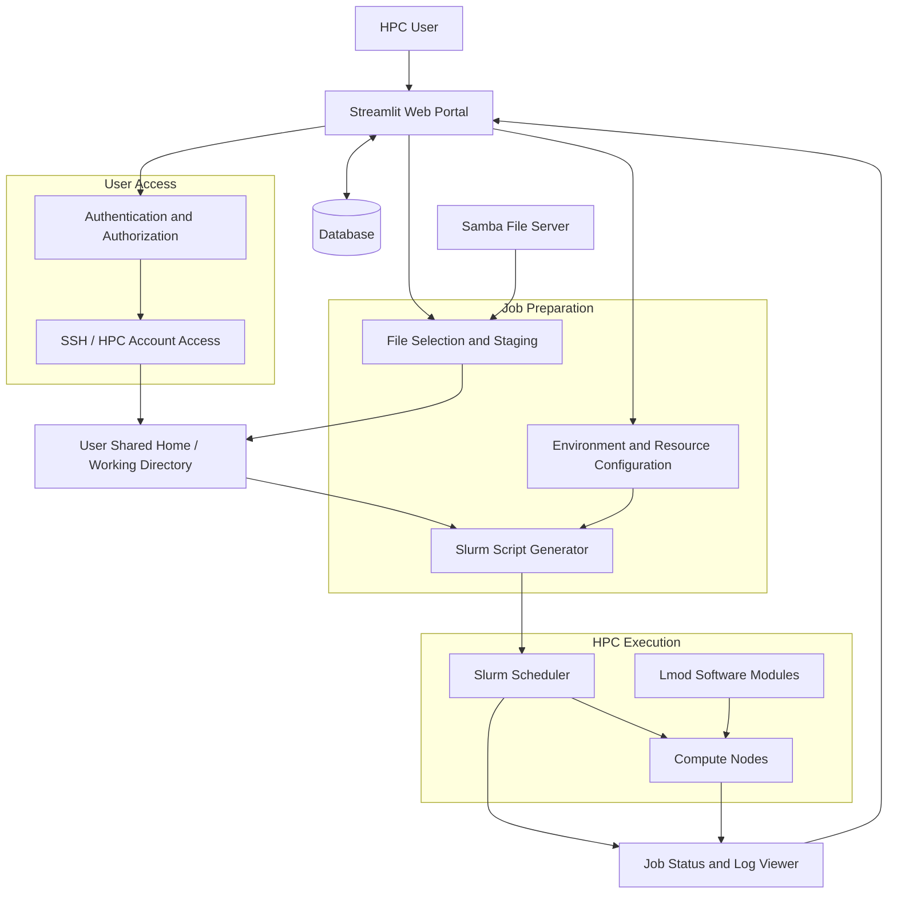

# HPC Job Submission Portal

**A Streamlit-based web interface for submitting, executing, and monitoring HPC workloads through Slurm.**

The HPC Job Submission Portal simplifies the traditional command-line workflow by providing users with a centralized interface to select input files, configure software environments and compute resources, submit jobs, and monitor execution status.

The portal integrates with an HPC environment built on Rocky Linux 9.8, using Slurm for workload scheduling, Samba for input-file storage, a database-backed file catalog, SSH for access to user working directories, and Lmod for software environment management.

## Overview

In a traditional HPC environment, users often need to locate input files, prepare batch scripts, specify resource requests, load software modules, submit jobs, and check execution status manually.

This project brings these operations into a single web-based workflow.

Users select the files they need, configure their environment and resource requirements, and click **Launch**. The backend stages the selected files, generates a Slurm batch script, submits the job, and makes job status and output information available through the interface.

## Key Features

- **Web-based job submission:** Launch HPC workloads through a Streamlit interface.
- **Database-backed file catalog:** Browse and select available input files.
- **Samba file integration:** Stage selected files from a centralized Samba file server into the user's shared home or working directory.
- **User-specific workspace:** Work with files and job scripts in the appropriate HPC account and directory.
- **Environment configuration:** Specify environment variables and required software settings.
- **Lmod integration:** Load compiler, MPI, and application modules in the job environment.
- **Dynamic batch-script generation:** Generate Slurm scripts based on the selected workload and resource requirements.
- **Resource configuration:** Configure supported options such as CPU count, memory, and wall time.
- **Automated job submission:** Submit generated batch scripts to Slurm.
- **Job status monitoring:** Check job state and execution details from the portal.
- **Output and error inspection:** Access available job logs to troubleshoot execution.

## Architecture



*The diagram represents the logical architecture. Actual authentication, file-transfer, scheduler, and monitoring connections depend on the implemented configuration.*

## Workflow

### 1. Access the portal

The user opens the Streamlit application and authenticates through the configured access mechanism. The application associates the session with the appropriate HPC user account and permissions.

### 2. Select input files

The portal retrieves file metadata from the database and displays the available files for selection.

The database provides the file catalog, while the actual files are maintained on the Samba file server.

### 3. Stage files into the working directory

After file selection, the backend copies the requested files from Samba into the user's shared home or job working directory.

Example workspace:

```text
/shared/home/<username>/
├── inputs/
├── jobs/
├── scripts/
└── results/
```

The portal should verify that the required files are available before permitting job submission.

### 4. Configure the job

The user specifies supported execution settings, including:

- CPU and task requirements
- Memory allocation
- Wall-time limit
- Software modules
- Environment variables
- Application-specific parameters

The portal validates the selections before using them to generate a batch script.

### 5. Generate and submit the batch script

The backend generates a Slurm script using the selected resources, environment settings, and application command.

A simplified example:

```bash
#!/bin/bash
#SBATCH --job-name=portal-job
#SBATCH --nodes=1
#SBATCH --ntasks=1
#SBATCH --cpus-per-task=4
#SBATCH --mem=8G
#SBATCH --time=01:00:00
#SBATCH --output=job-%j.out
#SBATCH --error=job-%j.err

set -euo pipefail

module purge
module load gcc/13.0

export OMP_NUM_THREADS="${SLURM_CPUS_PER_TASK}"

cd "${SLURM_SUBMIT_DIR}"

# Execute the selected application
./application input.dat
```

The example illustrates the generated script structure. The actual script must reflect the portal's selected application, available modules, and supported resource options.

When the user clicks **Launch**, the backend submits the script to Slurm, for example using:

```bash
sbatch generated-job.sh
```

The portal captures the returned job ID for subsequent status queries.

### 6. Monitor execution

The portal retrieves job information from Slurm and displays the available status and execution details.

Typical Slurm states include:

| State | Meaning |
|---|---|
| `PENDING` | Waiting for resources or a scheduling condition |
| `RUNNING` | Job is executing |
| `COMPLETED` | Job finished successfully |
| `FAILED` | Job failed |
| `CANCELLED` | Job was cancelled |
| `TIMEOUT` | Job exceeded its time limit |

Useful commands for backend validation:

```bash
squeue -j <job_id>
sacct -j <job_id> --format=JobID,JobName,State,Elapsed,ExitCode
```

Historical status availability depends on the cluster's Slurm accounting configuration.

## Technology Stack

| Layer | Technology | Responsibility |
|---|---|---|
| Web interface | Streamlit | User interaction and job configuration |
| Workload scheduler | Slurm | Resource scheduling and job execution |
| File catalog | Database | File metadata and selection |
| File server | Samba | Centralized input-file storage |
| Remote access | SSH | Access to HPC accounts and working directories |
| Environment management | Lmod | Loading compiler, MPI, and application environments |
| Operating system | Rocky Linux 9.8 | HPC infrastructure platform |
| Compute infrastructure | Linux compute nodes | Execute scheduled workloads |

Centralized user authentication may additionally use LDAP with PAM/NSS, depending on the deployed integration.

## Security Considerations

The portal interacts with user accounts, shared storage, and the workload scheduler. Appropriate security controls are essential.

- Enforce authentication and server-side authorization.
- Run jobs as the intended user rather than as root.
- Do not trust usernames or file paths supplied directly by the browser.
- Validate resource requests and environment variables.
- Restrict permitted Slurm directives and application commands.
- Prevent shell injection and path traversal.
- Protect SSH keys, database credentials, and Samba credentials.
- Enforce ownership and permissions on staged files, scripts, and logs.
- Ensure users can access only their authorized jobs and working directories.
- Avoid storing credentials in source code, logs, or version control.


Mark items complete only after verifying the corresponding behavior in the running environment.

## Project Goals

This project demonstrates how a web-based portal can simplify access to HPC resources while preserving Slurm's role as the workload scheduler.

It brings together file selection, job preparation, software environment configuration, resource requests, execution, and monitoring in a single user workflow.

The broader goal is to make HPC infrastructure more accessible to users while maintaining controlled resource allocation, reproducible job execution, and secure access to shared resources.