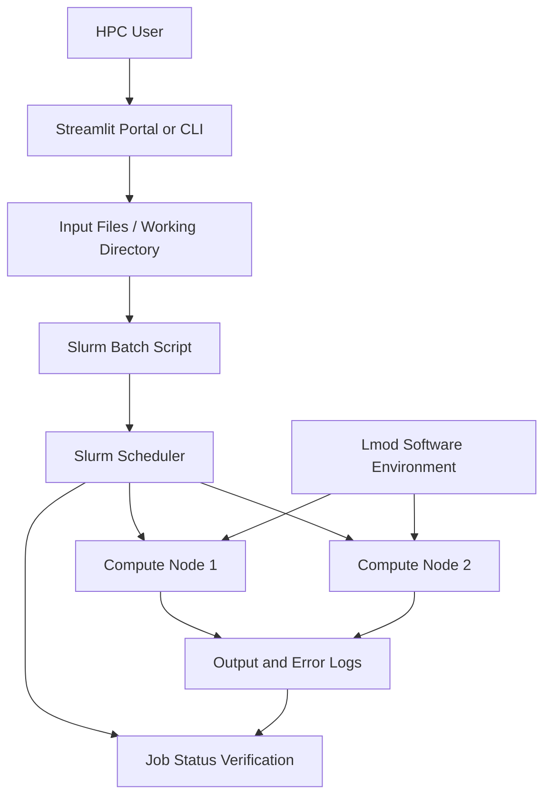

# HPC Workload Simulation and Validation

## 1. Overview

This directory documents workload execution and validation in the virtualized HPC environment running Rocky Linux 9.8.

The purpose is to demonstrate how users submit computational workloads through Slurm, how jobs are scheduled on compute nodes, and how execution results are collected and verified.

The simulation workflow can also be used to validate integration between the Streamlit job portal, Lmod software environments, shared storage, and Slurm.

## 2. Objectives

- Validate job submission and execution through Slurm.
- Demonstrate resource requests and scheduler behavior.
- Verify execution on the assigned compute nodes.
- Validate environment-module loading inside batch jobs.
- Inspect standard output, error logs, and exit status.
- Demonstrate the job lifecycle from submission to completion.
- Provide repeatable evidence for the HPC project.

## 3. Workload Execution Architecture



The selected compute node or nodes depend on the job's resource requests, available resources, partition configuration, and scheduling policy.

## 4. Prerequisites

Before running a workload, verify that:

- The user has an authorized HPC account.
- Slurm commands are available.
- Compute nodes are configured and available.
- The working directory and required input files are accessible.
- Required environment modules are installed and discoverable.
- The batch script requests resources supported by the cluster.

Useful checks:

```bash
sinfo
squeue
module avail
pwd
```

## 5. Example: CPU Workload

Create a small test program to validate the basic job-submission path.

Example batch script, `simulation-job.sh`:

```bash
#!/bin/bash
#SBATCH --job-name=hpc-simulation
#SBATCH --nodes=1
#SBATCH --ntasks=1
#SBATCH --cpus-per-task=2
#SBATCH --mem=1G
#SBATCH --time=00:05:00
#SBATCH --output=simulation-%j.out
#SBATCH --error=simulation-%j.err

set -euo pipefail

echo "Job ID: ${SLURM_JOB_ID}"
echo "Node list: ${SLURM_JOB_NODELIST}"
echo "CPUs allocated: ${SLURM_CPUS_PER_TASK}"
echo "Start time: $(date)"

hostname
lscpu | head -n 15

sleep 10

echo "Simulation completed at: $(date)"
```

Submit the job:

```bash
sbatch simulation-job.sh
```

The scheduler returns a job ID. Use it to monitor execution.

```bash
squeue -j <job_id>
```

After the job finishes, inspect the generated output:

```bash
cat simulation-<job_id>.out
cat simulation-<job_id>.err
```

Replace `<job_id>` with the actual ID returned by `sbatch`.

## 6. Validate MPI Execution

For distributed-memory workloads, use an MPI program and an MPI-enabled software environment that is compatible with the cluster configuration.

Example checks:

```bash
module avail
module load gcc/13.0
module list
which mpirun
mpirun --version
```

For a basic MPI batch job, the launch mechanism must match how OpenMPI was built and integrated with Slurm. Verify the installed MPI version, process-management support, and network configuration before choosing `srun` or `mpirun`.

Do not assume that a successful single-node job proves multi-node MPI communication works.

## 7. Job Monitoring

Use Slurm commands to examine the lifecycle and execution result.

```bash
squeue -u "$USER"
scontrol show job <job_id>
sacct -j <job_id> --format=JobID,JobName,State,Elapsed,ExitCode
```

- `squeue` shows queued and running jobs.
- `scontrol show job` displays detailed job information while the record is available.
- `sacct` reports historical job information when accounting is enabled and records are available.

For jobs submitted through the Streamlit portal, verify that the same job ID and relevant status are displayed in the UI.


## 8. Limitations

A successful test workload validates only the behavior exercised by that test. A basic CPU job does not prove MPI scalability, parallel-filesystem performance, scheduler failover, or production-level reliability.

Record the workload type, requested resources, software environment, and observed result for each test so that the evidence remains reproducible.